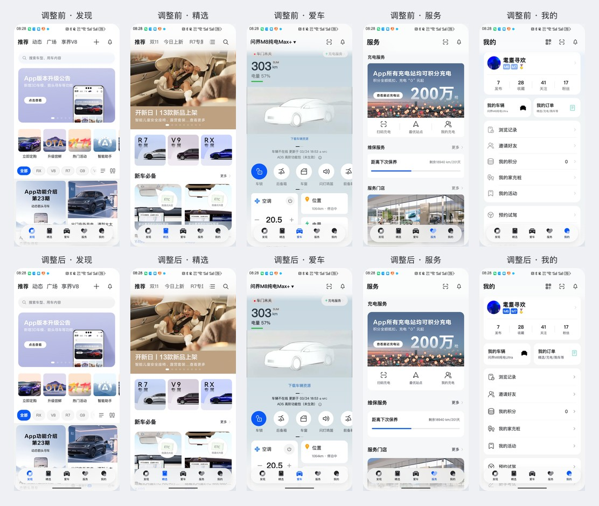
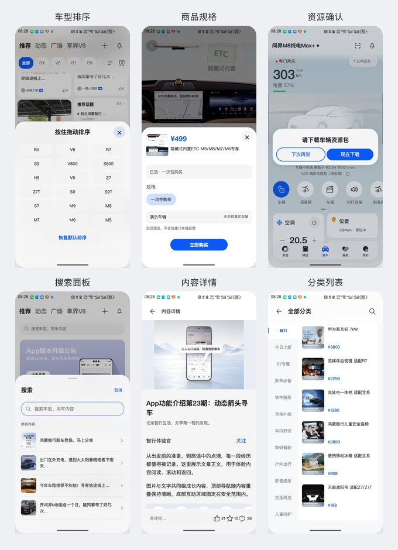

# 逐页组件样式自查与整改

2026-11-08。本轮检查的是已实现网页的**组件样式和状态**，不是ArkUI/HDS原生组件接入。原生接入仍为0，见[能力清单](capabilities.html)。仅载入`os7.html`的新样式层[os7-components.css](os7-components.css)，原版参考入口不载入。

## 官方依据与采用范围

| 编号 | 官方资料 | 本轮采用的明确规则 |
| --- | --- | --- |
| V1 | [底部页签](https://developer.huawei.com/consumer/cn/doc/doccenter-ux-design/bottomtab-0000001956787789/) | 居中悬浮页签使用56vp高胶囊容器，宽度响应内容/窗口而非写死；重复点击当前页签回到页顶或指定位置；内容横滑不切一级页签 |
| V2 | [通用应用UX体验标准](https://developer.huawei.com/consumer/cn/doc/doccenter-ux-design/ux-guidelines-general-0000001760708152/) | 点击热区不小于40vp×40vp；次级全屏页提供返回；固定操作避让底部导航区域；保证文字可读和布局不遮挡 |
| V3 | [半模态转场](https://developer.huawei.com/consumer/cn/doc/doccenter-references/api/ts-universal-attributes-sheet-transition/) | 当前接口默认圆角32vp；底部样式只显示上侧圆角，面板与背景蒙层明确分层 |
| V4 | [自定义弹窗](https://developer.huawei.com/consumer/cn/doc/doccenter-references/api/ts-methods-custom-dialog-box/) | 非customStyle的默认容器为32vp圆角，尺寸/位置考虑安全区域。本网页资源确认采用居中对话框转译 |
| V5 | [Button组件](https://developer.huawei.com/consumer/cn/doc/harmonyos-references/ts-basic-components-button/) | 区分强调、普通、文字按钮；按压状态可识别。胶囊是可选类型，不声称它是API18之后的默认类型（当前默认是ROUNDED_RECTANGLE） |

来源在本轮取得官方正文或明确索引段落。没有将穿戴间距、元服务卡片或历史V3资源值当作当前手机App规格。

固定网页内部画布采用1px近似1vp，外层等比缩放；这不等于真实手机密度/字体缩放的原生验收。普通业务卡片16px圆角、标题22px、分组行64px、正文16px、次要文字配色等为本项目统一取值，**不是未经证实的官方统一默认值**。

## 逐页整改清单

| 页面/组件 | 检出的差异 | 本轮调整 | 依据性质 |
| --- | --- | --- | --- |
| 五页共同底栏 | 固定340px宽、64px高，无系统导航条示意区域 | 左右16px留边、宽度自适应、56px高；底部28px为画布中的避让示意；重复点当前页签回页顶 | V1/V2；16/28为网页布局选择 |
| 发现：筛选/卡流/广场 | 32px筛选、部分图标热区窄，信息卡角度和辅助文字不统一 | 筛选与布局工具达到40px；信息卡统一16px圆角；点赞/更多等完整可见热区达到40px；字号/辅助色统一 | V2；业务卡外观为项目选择 |
| 发现：专题 | 业务操作栏未与新版底栏统一留白，初始说明仍显示历史频道名 | 独立操作栏与一级底栏保持间距，明确主次按钮；初始频道说明更新为享界V8 | V1/V2/V5及实际业务上下文 |
| 精选：频道与商品 | “双11”频道热区宽仅36px；搜索与列表形态混杂 | 频道最小宽40px；搜索统一普通填充背景；分类右侧单列条目对齐、字号14px | V2；列表排版为项目选择 |
| 爱车：操作区 | 充电服务高27px、下载入口高15px；车况辅助信息偏灰 | 两入口达到40px；车控圆形操作保留；空调开关与温度按钮40px；状态文字提高对比，信息卡与上下两块高度对齐 | V2；车控为业务组件 |
| 服务：卡片与服务宫格 | 更多入口热区小，卡片/宫格间距和字号分散 | 分组标题/更多对齐；充电操作区88px、宫格目标最小64px；正文与门店地址分级；卡片圆角统一 | V2；88/64/16为项目排版 |
| 我的：资料与分组列表 | 二级说明仅10px、行高/分隔缩进不一 | 说明12px；列表64px行高、24px图标、统一分隔缩进；快捷卡16px圆角、80px高 | V2；尺寸为项目排版 |
| 搜索/结果/次级页导航 | 返回按钮宽28px，热词目标不统一 | 返回40px；搜索动作与热词目标至少40px；保留独立返回和上下文 | V2 |
| 车型排序 | 30px条目和关闭按钮，28px面板圆角 | 32px上圆角；40px条目/关闭；面板500px容纳18车型；修复吸顶时新增车型点击丢失所属列表的问题 | V2/V3；高度为项目选择 |
| 商品规格 | 关闭按钮28px、28px面板圆角、正文挤压 | 32px上圆角、40px关闭/SKU/主操作；按内容定高并保留底部避让 | V2/V3/V5 |
| 消息/扫码/发布草稿/内容搜索 | 部分面板是悬浮小卡，底部/圆角/关闭方式不一致 | 同一底部半模态样式、32px上圆角、40px关闭/主操作、底部避让；内部输入框采用普通实体表面 | V2/V3/V5 |
| 车辆资源确认 | 小型底部卡片承担确认任务，尺寸与角色不协调 | 居中32px圆角对话框；主/次两个40px按钮 | V4/V5 |
| 内容详情与评论 | 关注和底部交互目标偏小，评论面板底部缺少统一避让 | 关注及互动至少40px；底部工具区留28px示意避让；评论32px上圆角 | V2/V3 |

## 实际截图

上排为调整前，下排为调整后；均为同一网页真实浏览器截图裁切，无生成式重绘。

## 实测与边界

- 五页浅色1280×900及深色360×780：底栏均56px；本次采样中完整可见且启用的按钮没有发现小于40px的目标，页面无横向溢出。
- 动态、广场、专题、精选其余三个频道已补查；未发现完整可见的小目标。
- 搜索、分类、结果、商品详情、规格、车型排序、发布菜单、文章/评论和资源确认已实际打开；排序与规格上圆角32px、关闭及选项热区通过。
- 吸顶后主导航与筛选之间间隙为0；重复点击当前底部页签回到0；新增M9筛选、菜单、弹层关闭与逐层返回可操作，本轮路径无页面运行错误。
- 弹簧回归、脚本语法与差异空白检查通过。原生字体/Symbol、系统材质和全部App业务子页仍未接入；本报告不将尚未实现的页面列为已验收。

本轮完成的是已实现页面的样式校正；不能据此称全部像素与原生组件默认渲染完全一致。
