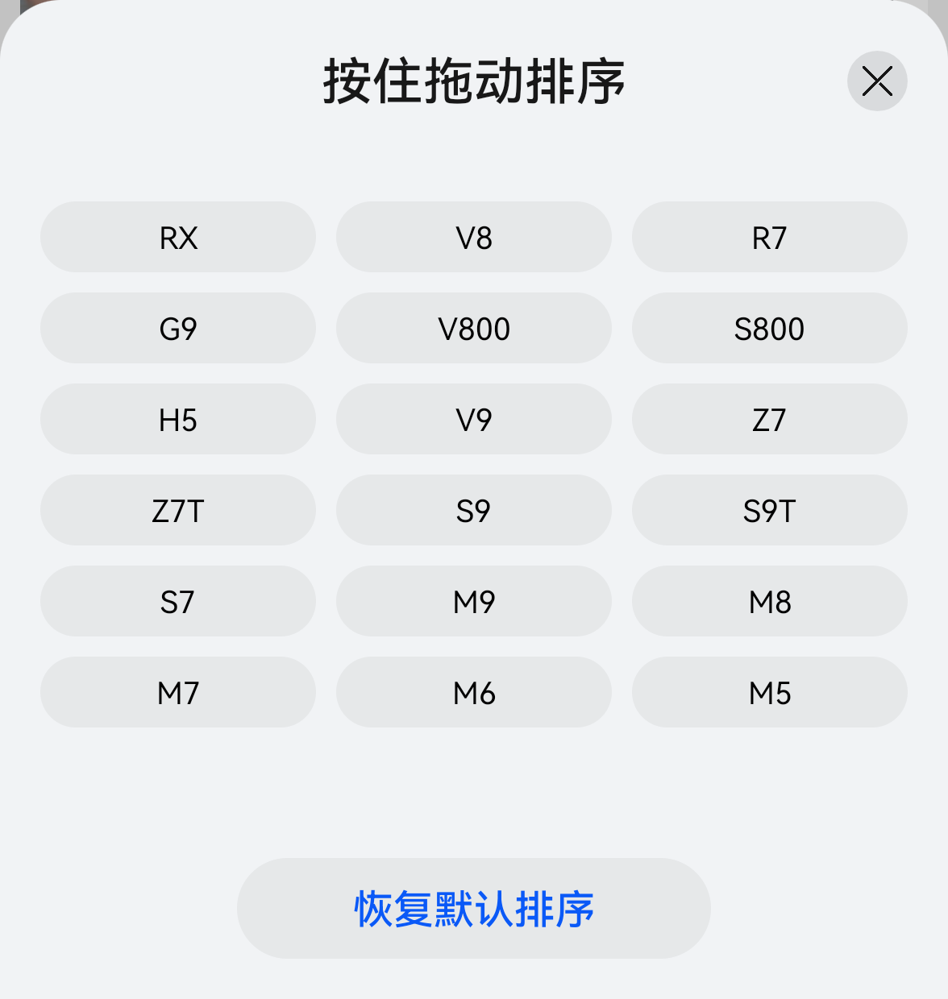

# 实机交互对照：3.0.3.300

2026-11-02。状态：首批采样已完成，后续采样因手机切换其他应用暂停，**全量交互复刻未完成**。

[飞书分层清单与鸿蒙7适配研究](https://wcnmi1hwg5td.feishu.cn/docx/LbHIdk0oco9QEzxFRxMcLtA8nhf)已写入指定文件夹并回读确认。

## 已确认与修订

| 功能ID | 实机观察 | 预览修订 | 证据 |
| --- | --- | --- | --- |
| NAV-01 | 发现首屏四频道；上滑后车型栏停在顶部频道下方 | 保留吸顶；运营第四频道更新为享界V8 | 本地NAV-01_01、02截图/XML |
| SEA-01 | 三横线打开车型顺序面板；18车型三列、关闭、恢复默认 | 移除错误的文章排序；增加网页鼠标/触摸拖排、方向键重排、恢复默认；顺序仅本页内存 | SEA-01_02，见下图 |
| NAV-02 | 精选单行频道，无单独“精选”标题 | 移除额外标题；恢复98px顶部区；频道为推荐/双11/今日上新/R7专属 | 本地NAV-02_01截图/XML |

普通卡片保持实体；排序容器按半模态系统材质方向适配，网格不嵌套玻璃。深浅色、减少动态和关闭材质沿用统一偏好。所有网页参数为演示值。

## 验证记录

真实浏览器：鼠标RX→V8后顺序为V8/RX/R7；恢复后RX/V8/R7；关闭返回；360宽度文档无横向溢出；精选无额外标题，四频道文本存在。窄屏末尾频道可横向查看。原版入口不加载本次OS7样式与脚本。

深色与减少动态：排序打开、恢复默认、Esc关闭均通过，关闭后dialog数量0；语法、弹簧模型回归与diff空白检查通过。截图稳定后核对手机画布仅1个、336×约709，底栏在安全范围内。测试不证明与原生动效参数相同。

实机仅观察排序面板打开/关闭，未拖动更改用户真实偏好，因此不宣称已验证服务端持久化。未测搜索、详情、刷新阈值和曲线，不能称完整还原。

## 资料与接续

- [研究简报](研究简报.md)
- [覆盖台账](coverage-ledger.csv)
- [当前版本清单](versions/3.0.3.300/功能清单.md)
- [演进总表](功能清单_演进总表.md)
- [接续状态](resume-state.json)
- [待用户配合](用户补充体验清单.md)

原始截图/XML在仓库外的`output/device-research/20261102_hima/`和手机专属研究相册，包含公开社区内容，未批量上传。夹杂通知的截图与非目标应用XML已删除；公开材料仅保留上面的组件裁切。

官方资料：本轮通过DevEco CLI读取`最佳实践/沉浸光感/bpta-spatiality-immersive`，说明HDS导航/悬浮Tabs、渐变模糊、自适应材质、MiniBar和握姿。MiniBar尚无业务证据，不为凑特性增加。详细12层矩阵见飞书，不把Android样式当作鸿蒙官方规范。
