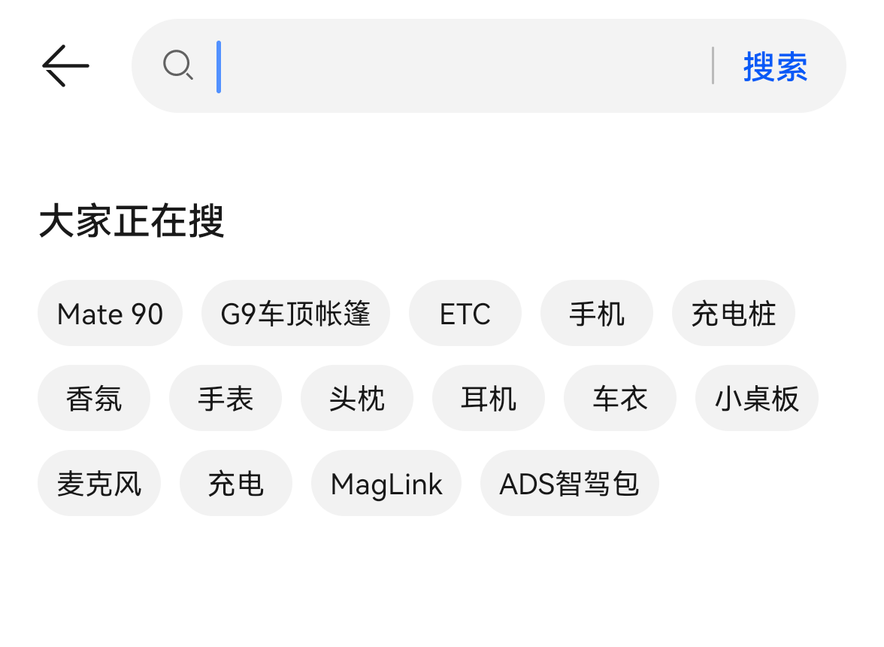
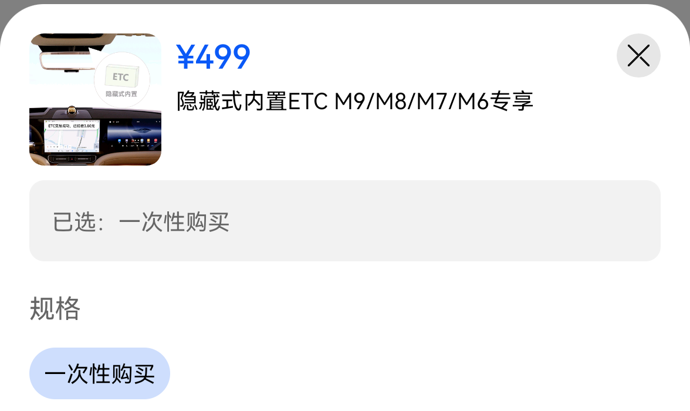

# 第二批：搜索、详情、分类与一级页

2026-11-02，用户确认手机可继续采样后恢复；设备/包名未变。已登录并存在关联车辆，但未核验车主或授权角色，不保存车辆身份字段。原始证据在本地同一会话；台账现17个检查项，15项实测、2项敏感边界。这是本轮抽样分母，**不是整个App覆盖率**。

## 实机事实与网页落地

| 功能ID | 当前实机证据 | 实机事实 | 本轮网页处理 |
| --- | --- | --- | --- |
| SEA-02 | 02搜索/03结果/04返回结果/05返回热词 | 搜索为独立页；热词和键盘；ETC进入独立结果；逐层返回 | 新增搜索→结果路由，移除精选搜索半模态，提供热词/历史/清空/本地结果 |
| DET-02 | 01详情/02规格裁切/03关闭规格 | 图集、标题价格、已选/服务/适配车型；已选打开规格半模态 | 卡片和结果可进入详情；图集横滑、内容滚动、适配车型展开、规格层开关与返回；购买停在演示边界 |
| SEA-03 | 02分类/NAV-02_03返回 | 左侧分类，右侧纵向商品列表，无一级底栏 | 当前运营分类标签、右侧改单列；分类→搜索/商品详情后可返回分类 |
| DET-01 | 01官方文章/02返回 | Hero、正文、作者、固定评论/赞/收藏/评论数；返回原列表位置 | 内容卡片可进入示例文章；底部互动仅本地状态；评论草稿保留本页，非真实发布 |
| NAV-03 | 01动态/03广场/04运营 | 动态为双列卡流；广场活动；第四频道是享界V8专题 | 动态改双列；专题更新首屏；旧尊界内容不再沿用 |
| SVC-01 | 01/02 | 充电、维保、门店、13项更多服务入口 | 更新服务宫格名称/顺序；下级业务未实施 |
| CAR-01 | 01/02 | 车辆模型、状态、横向控制入口、空调/位置/电量及列表 | 仅验证原网页结构；3D模型及真实车辆动态未复刻，不将数值同步到公共Demo |
| ACC-01/SET-01 | 我的下部/设置 | 我的分组列表与设置11项；身份区不保留 | 仅建立当前版本清单，设置子页仍待实现 |

## 鸿蒙7组件适配补充

- 搜索/结果/内容详情/商品详情属于Navigation目的页；顶部按滚动重叠做渐变模糊、前景保持清晰，详情不补一级底部页签。
- 已选规格属于半模态：容器使用系统材质方向，SKU、已选和车辆行保持实体表面；底部购买位置稳定，不随握姿迁移。
- 内容详情底部为阅读互动工具区：低风险按压反馈和安全区避让；编辑态优先键盘避让及草稿恢复，不能把帖子发布结果用粒子冒充。
- 分类分栏和商品行属于内容布局，不逐行玻璃化；右侧独立滚动且返回保留上级选择。
- 动态两列卡片是App结构观察，系统材质/运动使用HarmonyOS官方能力判断；Android截图不能作为官方参数来源。

## 未闭合与反例

- NAV-03_02内容区左滑未切换频道；文件名含swipe-square只表示当时的测试意图，实际仍为动态。网页既有频道横滑仅为演示机制，未宣称与当前App一致。
- NAV-03_05仅证明下滑后恢复顶部。设备未提供screenrecord命令，未取得刷新逐帧证据，未测阈值、时长、速度曲线。
- SEA-03_01实际仍在精选返回态，正确分类证据为SEA-03_02。SEA-02_05实际为返回热词页，不是直接回精选；这些文件名不用于推断状态。
- 规格原截图包含车辆身份字段，已在本地和手机移除原图，仅保留上方安全裁切。未改真实排序、未购买、预约、发布、点赞或控车。
- 分享、消息、扫码、登录/失败态、设置子页、持续任务MiniBar、3D旋转、多设备和所有业务落地页未完成。发现未收敛，不能称“全量完成”。

## 网页验收路径

精选→搜索→ETC→第一条结果→已选→关闭规格→返回详情/结果/热词/精选；分类→搜索→返回分类；发现卡片→正文滚动→本地评论草稿→返回原流。检查360窄屏、深色、减少动态、Esc/浏览器后退、焦点恢复、底栏显隐和无运行错误。原版index入口不加载os7-routes。

已实测网页：ETC结果→商品详情→规格开关；浏览器后退依次回结果、含ETC历史的热词页、精选根页；分类→搜索Esc返回保留分类；内容卡片Enter进入、本地草稿保存后可重开；Esc逐层退出；动态存在双列feed-grid；360宽度无横向溢出、深色/减少动态详情可用。浏览器控制台0错误0警告，语法、diff空白和弹簧回归通过。图片/内容仍有演示素材，未做逐像素或真机帧率验收。
